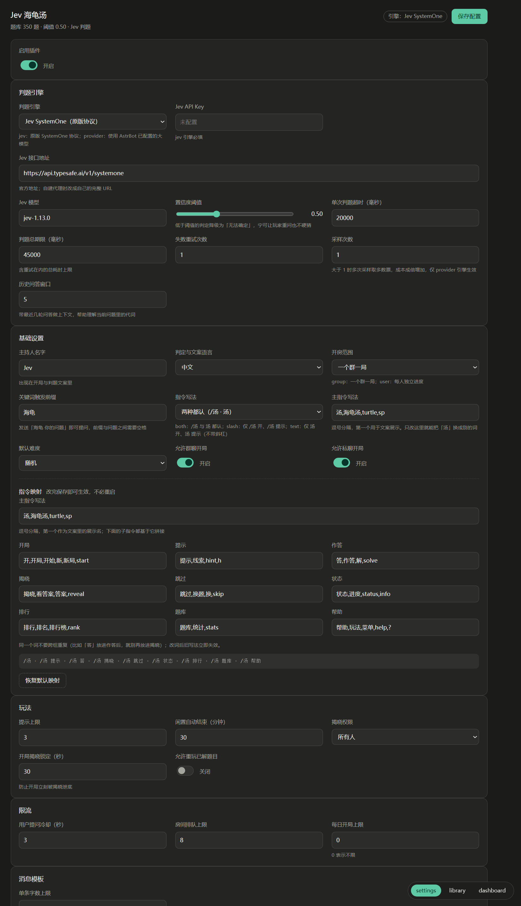
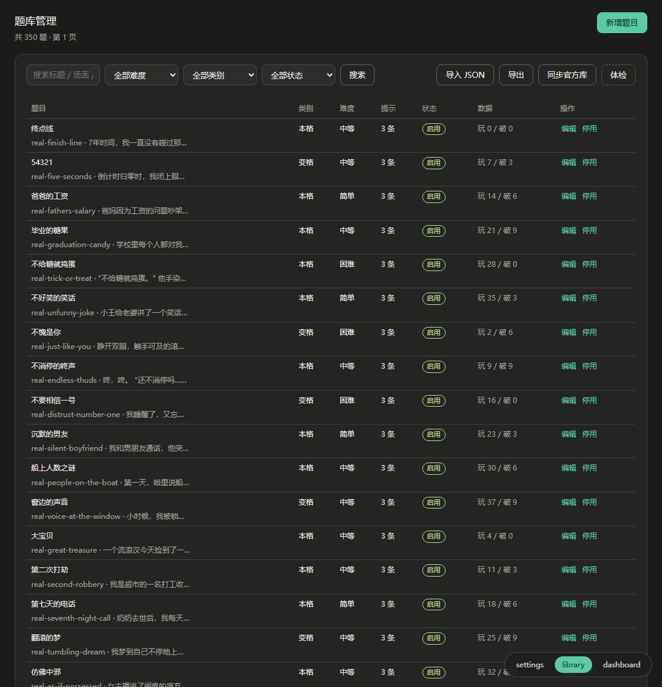
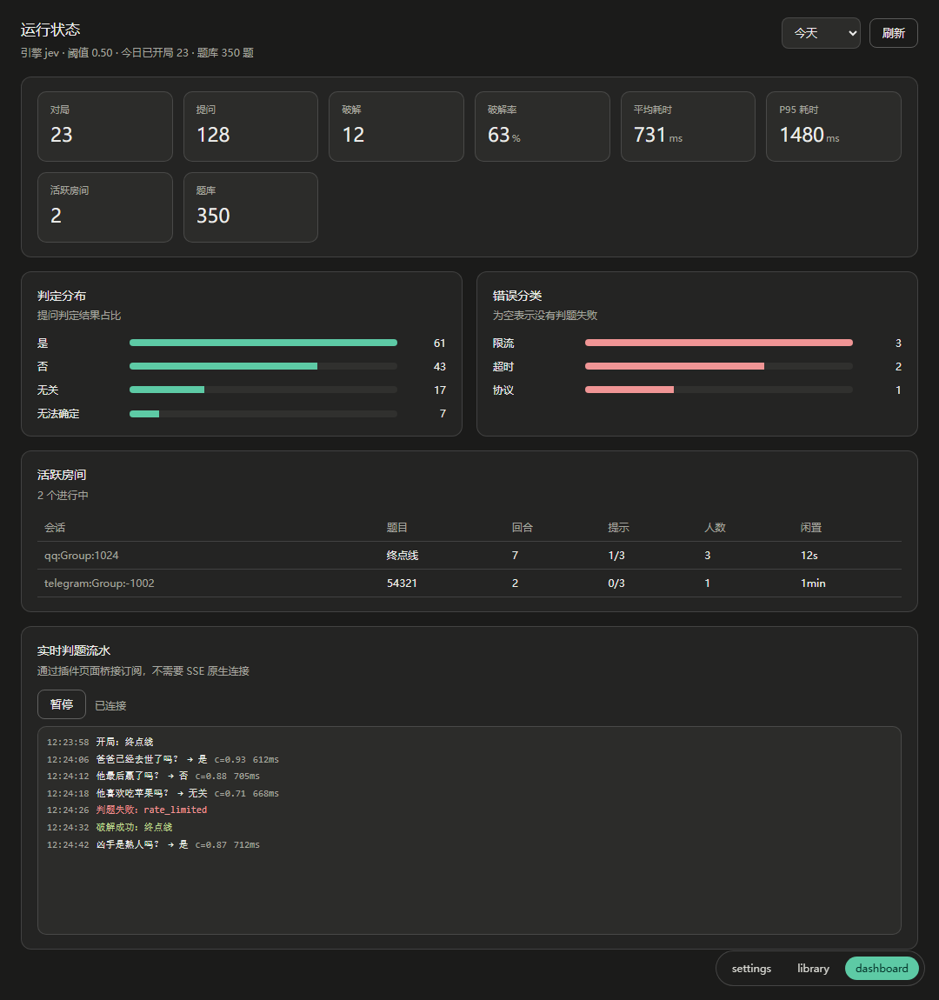

# Jev 海龟汤 · AstrBot 插件

[](https://github.com/link0518/astrbot_plugin_situation_puzzle/actions/workflows/ci.yml)
[](LICENSE)
[](https://github.com/AstrBotDevs/AstrBot)

把 [Situation-Puzzle](https://github.com/ZeroTang05/Situation-Puzzle) 的「AI 主持海龟汤」搬进 IM。

群聊即房间：@我、回复我，或发「海龟 你的问题」都能提问；我只回答 **是 / 否 / 无关**，
拿不准就说 **无法确定** —— 不硬猜，也不剧透。内置 350 道题，装完即玩。



---

## 玩法

| 指令 | 说明 |
|---|---|
| `/汤` | 随机开局，也可 `/汤 开 困难`、`/汤 开 #real-finish-line` |
| `/汤 答 <推理>` | 提交还原，判定 破解成功 / 接近真相 / 还没猜对 |
| `/汤 提示` | 逐条解锁提示（默认 3 条） |
| `/汤 揭晓` | 公布汤底；开局 30 秒内不允许，防开局泄底 |
| `/汤 跳过` | 放弃当前题并立刻换一题 |
| `/汤 状态` | 当前题、回合数、剩余提示、参与人数 |
| `/汤 排行` | 本群解谜榜 |
| `/汤 题库` | 题库统计与当前引擎（管理员可看） |

别名：`海龟汤` / `turtle` / `sp`。

指令写法可在面板里改（`command_style`）：`both` 默认，`/汤` 与 `汤` 都认；`slash` 只认 `/汤`；
`text` 只认 `汤`。选 `text` 时，机器人发出的文案也会把「/汤 提示」写成「汤 提示」。

主指令和每个子指令的词都能换，见下文「指令映射」：把「汤」改成「线索」、「提示」改成「给点线索」后，
`/线索 给点线索` 直接生效，帮助与开局文案也会自动跟着换。

### 提问的三条通道

1. **@bot** —— `@机器人 她是自杀吗？`
2. **回复 bot 的消息** —— 引用任意一条机器人回复直接发问
3. **关键词前缀** —— `海龟 她是自杀吗？`（前缀可在面板改，问题与前缀之间需要空格）

优先级：`指令 > 回复bot > @bot > 关键词`。三条通道之外的消息一律不响应，**不会吃掉群里的闲聊**。

---

## 安装

### 插件市场

在 AstrBot WebUI → 插件 → 插件市场搜索「Jev 海龟汤」安装。

### 手动

```bash
cd AstrBot/data/plugins
git clone https://github.com/link0518/astrbot_plugin_situation_puzzle.git
```

仓库根目录就是插件目录（`metadata.yaml` 在最外层），克隆后无需改名或移动。
重启 AstrBot 或在插件页点「重载插件」，首次加载会把内置题库写入 SQLite。

---

## 配置

配置分两层，都在 WebUI 里完成，不需要改代码。

### 1. 插件配置页（AstrBot 原生）

由 `_conf_schema.json` 自动渲染，分 5 组：基础设置、判题引擎、玩法、限流、消息模板。
适合快速改几项：主持人名字、关键词前缀、置信度阈值、超时与重试、提示上限、消息模板。

`judge.provider_id` 是一个下拉框，直接列出你已配置的模型 —— 切到 `provider` 引擎时不用手填 ID。

### 2. 插件详情页的三个视图

| 视图 | 用途 |
|---|---|
| **设置** | 引擎切换（jev / 大模型）、**连通性自检**、**阈值校准**、消息模板实时预览 |
| **题库** | 搜索、编辑、启用/停用、导入导出、同步官方库、体检 |
| **运行状态** | 对局数、破解率、判题 P95、判定与错误分布、活跃房间、实时流水（SSE） |

**连通性自检**是最该先用的功能：写一个问题点「试判」，立刻看到判定、置信度、耗时和引擎。
如果 Key 不对，这里会直接告诉你 `auth` 失败，不用去翻日志。

**阈值校准**会拿内置题「终点线」跑 6 个已知答案的问题，给出命中率。
`provider` 引擎的置信度是模型自报的、没有校准过，建议先用这个功能确认阈值是否合适。

| 题库 | 运行状态 |
|---|---|
|  |  |

#### 指令映射

面板「基础设置 → 指令映射」里，主指令和每个子指令的词都能换，逗号分隔：

| 项 | 默认写法 |
|---|---|
| 主指令 | `汤,海龟汤,turtle,sp` |
| 开局 | `开,开局,开始,新,新局,start` |
| 提示 | `提示,线索,hint,h` |
| 作答 | `答,作答,解,solve` |
| 揭晓 | `揭晓,看答案,答案,reveal` |
| 跳过 | `跳过,换题,换,skip` |
| 状态 | `状态,进度,status,info` |
| 排行 | `排行,排名,排行榜,rank` |
| 题库 | `题库,统计,stats` |
| 帮助 | `帮助,玩法,菜单,help,?` |

规则：

- **跨组重名会被拒绝**：保存时提示「同时映射到 A 和 B」，整批改动都不生效，不会只改一半。
- **匹配取最长的词**：`答` 在作答、`答案` 在揭晓，`/汤 答案` 走揭晓，不会被拆成「答 + 案」。
- **清空即禁用**：清空「揭晓」后 `/汤 揭晓` 不再响应；主指令至少要保留一个写法。
- 保存即生效，进行中的对局不受影响；帮助文案与开局提示里的示例会自动换成新词。

---

## 判题引擎

### `jev`（默认）

复刻原项目 `packages/jev` 的 SystemOne 协议：

```json
{
  "model": "jev-1.13.0",
  "state": { "汤面": "...", "真相": "...", "类别": "...", "历史问答": [...], "玩家提问": "..." },
  "questions": { "ask": { "type": "choice", "instructions": "...", "criteria": { "是": "...", "否": "...", "无关": "..." } } }
}
```

默认接口 `https://api.typesafe.ai/v1/systemone`，模型 `jev-1.13.0`。
需要在面板填 `jev_api_key`；`base_url` 与 `model` 也可自定义（自建代理时填自己的完整 URL）。
响应必须带 `probabilities`，缺了按**协议错误**处理 —— 这是原项目的硬约束，插件不改。

### `provider`（可选）

走 AstrBot 的 `llm_generate`，要求模型输出 `{"choice": "...", "confidence": 0.87}`。
可设 `self_consistency` 做多次采样投票。解析失败会重试一次，仍失败就回「主持人走神了」，**绝不猜一个答案**。

### 失败与降级

| 情况 | 回复 |
|---|---|
| 401 / 403 | 提示管理员检查 Key |
| 429 | 提示被限流，稍后再问 |
| 超时 / 网络 / 5xx | 提示服务暂时不可用 |
| 输出不合法 | 提示再问一次 |
| 置信度低于阈值 | 「这个问题我得再看看（无法确定）」 |

阈值默认 0.5，可在 0.3~0.9 之间调。

---

## 数据

- 数据目录：`data/plugin_data/astrbot_plugin_situation_puzzle/`（不放在插件目录，更新插件不会丢）
- `situation_puzzle.db`：题库、对局、判题流水、计分
- `imports/`、`exports/`：面板导入导出的中转文件

汤底只参与判题，正常提问与提示的回复里不会出现；只有「破解成功」和「揭晓」会输出。

---

## 开发

```bash
python -m pip install -r requirements.txt pytest ruff
python -m pytest tests -q      # 81 个用例：协议、提示词、路由、指令映射、房间、防剧透、端到端、面板接口
python -m ruff check .
python -m ruff format --check .
```

不装 AstrBot 也能看面板：`dev/preview/` 里有一套假 bridge，把 `views/` 直接跑起来。

```bash
python -m http.server 5173
# 打开 http://127.0.0.1:5173/dev/preview/index.html?view=settings
```

`view` 可选 `settings` / `library` / `dashboard`，加 `&theme=light` 切浅色。

目录：

```
main.py                 入口：指令、三通道路由、配置与生命周期
core/                   路由、房间、SQLite、模板、配置
judge/                  协议、提示词、jev 引擎、provider 引擎、重试
web/api.py              面板后端 15 个接口
views/                  settings / library / dashboard 三个可视化视图
resources/library.seed.json   内置题库
tests/                  单测与桩件端到端测试
dev/preview/            假 bridge 面板预览
docs/PLAN.md            设计文档与实施记录
```

调试时把仓库软链到 `AstrBot/data/plugins/astrbot_plugin_situation_puzzle`，
改完在插件页点重载即可；`views/` 改静态文件刷新页面就行。

---

## 常见问题

**面板里看不到三个视图？**
需要 AstrBot `>=4.16`，且从「插件详情页」进入。版本过低时插件会降级为只有原生配置页，功能不受影响。

**群里 @ 了没反应？**
先 `/汤` 开一局，再提问；没有进行中的对局时，只有「海龟 」前缀会自动开局。

**一直回「无法确定」？**
`jev` 引擎检查 Key 与额度；`provider` 引擎换一个更强的模型，或在设置页跑一次校准看看命中率。

**题库为什么是 350 题？**
与上游 `main` 分支保持同步。上游 `dev` 分支另有 446 题的实验批次，但该分支没有逐题出处表，
本插件不收录，可用面板的「同步官方库」按需拉取。

---

## 许可与致谢

- 本插件以 **GPL-3.0** 发布，判题协议、提示词与题库移植自
  [ZeroTang05/Situation-Puzzle](https://github.com/ZeroTang05/Situation-Puzzle)（GPL-3.0）。
  第三方内容与商标说明见 [NOTICE](NOTICE)。
- 题库包含平台原创与公开节目材料的改编，逐题出处见上游
  [`data/library-sources.md`](https://github.com/ZeroTang05/Situation-Puzzle/blob/main/data/library-sources.md)；
  转载与再分发请保留出处。
- 运行在 [AstrBot](https://github.com/AstrBotDevs/AstrBot) 之上。

改动记录见 [CHANGELOG.md](CHANGELOG.md)，设计文档见 [docs/PLAN.md](docs/PLAN.md)。
